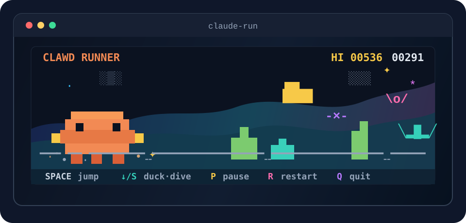

# Clawd Runner 🦀

A Chrome-dino-style jumping game for your terminal, starring Clawd — the Claude Code crab. Jump over cacti, duck under flying bugs, and chase a high score.

<p align="center">
  
</p>

## Play it

**Option 1 — install from npm:**

```sh
npm install -g claude-minigame
claude-run
```

**Option 2 — run from source:**

```sh
git clone https://github.com/valenciana-nc/Claude-Minigame
cd Claude-Minigame
npm link        # puts `claude-run` on your PATH
claude-run
```

## Controls

| key | what it does |
| --- | --- |
| `SPACE` / `↑` / `W` | jump |
| `↓` / `S` | duck — press in mid-air to dive down fast |
| `P` | pause |
| `R` | restart |
| `Q` / `ESC` | quit |

## How it works

- Your score is the distance you travel. The game keeps getting faster.
- **Cacti** (green): jump over them. Tall ones need an earlier jump.
- **Flyers** (bugs and birds, appear after ~110 points): low ones you jump over, mid-height ones you duck under. They fly a little faster than the ground scrolls.
- The gap before every obstacle is always big enough to clear — the game is hard but fair.
- Night falls every 480 points. Your best score is saved between sessions.

## Options

```sh
claude-run --skin claude   # play as the Claude Code cloud instead of the crab
claude-run --seed 7        # same run every time (good for practice)
claude-run --plain         # no colors
```

## Launch it from Claude Code (optional)

You can put a clickable crab in your Claude Code statusline — ctrl+click it and the game opens, like the dino when your wifi dies.

1. **Register the `clawd://` link handler** (Windows only for now — macOS/Linux PRs welcome):
   ```powershell
   powershell -ExecutionPolicy Bypass -File tools\install-protocol.ps1
   ```
   Test it: `start clawd://play` should open the game in a new terminal window.

2. **Add the crab to your statusline.** In `~/.claude/settings.json`:
   ```json
   "statusLine": { "type": "command", "command": "node <ABS PATH>/tools/statusline-basic.js" }
   ```

   Already have a custom statusline? Add these lines to it:
   ```js
   const ORANGE = '\x1b[38;2;217;119;87m', DIM = '\x1b[2m', RESET = '\x1b[0m';
   const link = (t, u) => '\x1b]8;;' + u + '\x07' + t + '\x1b]8;;\x07';
   out += '  ' + link(ORANGE + '▐▛▜▌' + RESET + DIM + ' play' + RESET, 'clawd://play');
   ```

3. Ctrl+click the crab at the bottom of any Claude Code session. Your terminal may ask permission the first time — that's normal.

## Uninstall

```powershell
powershell -ExecutionPolicy Bypass -File tools\install-protocol.ps1 -Uninstall
npm unlink -g claude-minigame
```

Then remove the crab lines from your statusline. High scores live in `~/.claude-minigame.json` if you want to wipe those too.

## For developers

```sh
npm test                 # headless tests (physics, collisions, rendering, input)
npm run snapshot         # render bot-played frames as text (debugging/CI)
```

The game logic (`src/engine.js`) has no terminal code in it — it's pure simulation, so it's easy to test. `bin/clawd.js` handles the screen and keyboard.

## Credits

Clawd is [the unofficial mascot of Claude Code](https://github.com/anthropics/claude-code/issues/8536) by Anthropic. This is a fan project, not affiliated with or endorsed by Anthropic. Inspired by Chrome's `chrome://dino`.

MIT, see [LICENSE](LICENSE).
